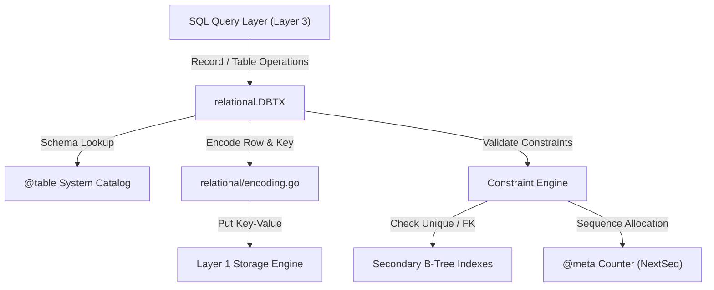

# Layer 2 — Relational Layer (Tables, Records, Encoding & Constraints)

> **Module Responsibility**: Maps relational concepts (typed tables, rows, primary & secondary B-Tree indexes, schema catalogs, default values, and relational constraints) onto the Layer 1 Key-Value engine.

---

## 📂 Directory Structure & File Map

```text
byodb/
└── relational/             # Relational mapping engine
    ├── schema.go           # TableDef, catalog management (@meta, @table), view metadata, sequence counters
    ├── encoding.go         # Order-preserving binary byte encoding (int64, float64, bytes, null)
    ├── table.go            # Row CRUD ops (Get, Set, Delete), secondary index maintenance, constraint checks
    ├── value.go            # Value struct, Record struct, type system & default value evaluation
    └── relational_test.go  # Relational layer unit & encoding tests
```

---

## 🏗️ Architecture & Component Flow



---

## 🔑 Key Concepts & Mechanisms

### 1. Data Types & Order-Preserving Byte Encoding (`relational/encoding.go`)

BYODB supports four core data types:
| Type | Value Constant | Description |
| :--- | :--- | :--- |
| `bytes` | `TypeBytes = 1` | Arbitrary text / binary string |
| `int64` | `TypeInt64 = 2` | Signed 64-bit integer |
| `float64` | `TypeFloat64 = 3` | IEEE 754 64-bit floating point number |
| `null` | `TypeNull = 4` | SQL NULL value |

#### Numeric Order-Preserving Trick
In a B+Tree, keys are ordered lexicographically by raw byte values. To ensure that signed numbers sort correctly as raw bytes:
- **`int64`**: The sign bit is flipped (`i64 ^ (1 << 63)`), converting negative numbers to smaller unsigned byte representations than positive numbers.
- **`float64`**: Positive floats flip the sign bit; negative floats flip all bits.

---

### 2. Key Prefixes & System Catalog (`relational/schema.go`)
To isolate data between different tables and indexes, every B-Tree key starts with a **4-byte uint32 prefix**:

```text
Prefix 1: @meta   (Database metadata, next prefix counter, sequence counters, views)
Prefix 2: @table  (JSON serialized TableDef schemas for every user table)
Prefix 3+: User tables and secondary indexes
```

---

### 3. Key-Value Storage Format for Rows & Indexes (`relational/table.go`)

#### Primary Key Mapping
```text
Key:   [Prefix] + [Encoded Primary Key Columns...]
Value: [Encoded Remaining Non-PK Columns...]
```

#### Secondary Index Mapping
```text
Key:   [Prefix] + [Encoded Indexed Columns...] + [Encoded Primary Key Columns...]
Value: [Empty]
```
> **Note**: Appending the Primary Key to the secondary index key makes every index entry unique in the B-Tree while allowing range queries to map back to the primary row.

---

### 4. Constraint Enforcement (`relational/table.go` & `relational/schema.go`)

#### A. `AUTO_INCREMENT`
- Table schemas specify `AutoIncCol`.
- When inserting a row without providing an ID (or passing `0`/`NULL`), `tx.NextSeq(tableName)` increments the sequence counter stored under `seq:<tablename>` in `@meta` and assigns the ID.

#### B. `UNIQUE` Constraints
- Columns marked `UNIQUE` generate a secondary index.
- Before setting a row, `tx.checkUniqueConstraints()` scans the B-Tree index to verify that no existing row shares the same non-null unique values.

#### C. `FOREIGN KEY` & `ON DELETE CASCADE`
- On `INSERT`/`UPDATE`: `tx.checkForeignKeysOnSet()` verifies that referenced parent table keys exist.
- On `DELETE`: `tx.checkForeignKeysOnDelete()` scans referencing child tables. If child rows exist and `ON DELETE CASCADE` is set, child rows are deleted recursively; otherwise, deletion is refused (`RESTRICT`).

---

## 🛠️ Data Structures Summary

### `TableDef` (`relational/schema.go`)
```go
type TableDef struct {
    Name        string          `json:"name"`
    Cols        []string        `json:"cols"`
    Types       []uint32        `json:"types"`
    Defaults    []Value         `json:"defaults"`
    Checks      []string        `json:"checks"`
    AutoIncCol  string          `json:"auto_inc_col,omitempty"`
    Uniques     [][]string      `json:"uniques,omitempty"`
    ForeignKeys []ForeignKeyDef `json:"foreign_keys,omitempty"`
    Indexes     [][]string      `json:"indexes"`  // Indexes[0] is Primary Key
    Prefixes    []uint32        `json:"prefixes"` // Key prefix per index
}
```

### `Record` & `Value` (`relational/value.go`)
```go
type Value struct {
    Type uint32
    I64  int64
    F64  float64
    Str  []byte
}

type Record struct {
    Cols []string
    Vals []Value
}
```

---

## 🧪 Verification & Unit Tests
Run the relational test suite:
```bash
go test ./relational
```
